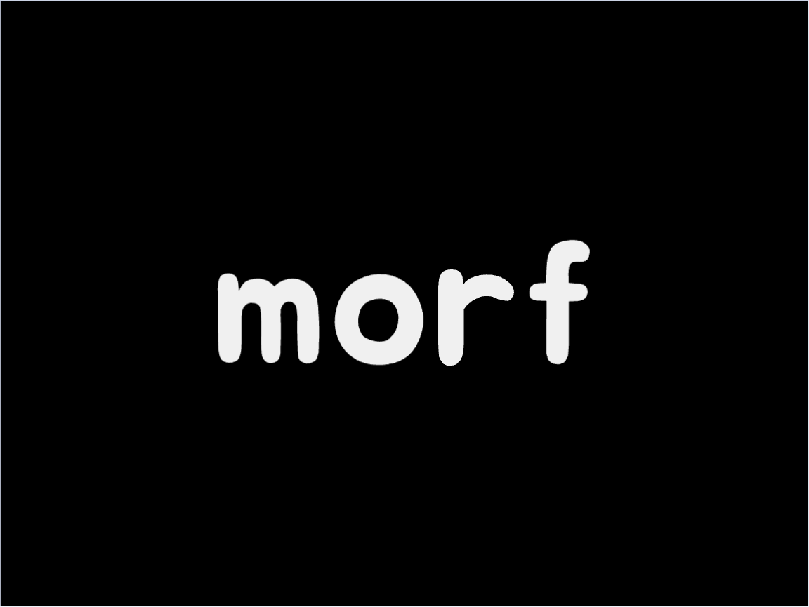

# morf

**Diff and merge 3D assets with Git.**

Morf is an open-source C++ CLI for comparing 3D geometry, reviewing changes in a viewer, and resolving three-way merges. It integrates with Git and Git LFS.

Currently **experimental and OBJ-only**. The long-term goal is semantic version control for meshes, materials, shaders, and scenes. Merges are not yet lossless: OBJ UVs, normals, and material information may be discarded. Keep your originals under version control.

## Build

Requires CMake 3.16+, a C++17 compiler, and Git. Dependencies are configured by CMake.

```sh
git clone https://github.com/yparmar2024/morf.git
cd morf
cmake -S . -B build -DCMAKE_POLICY_VERSION_MINIMUM=3.5 -DBUILD_TESTING=OFF
cmake --build build --parallel
./build/cli/morf --help
```

For the commands below, add `build/cli` to your `PATH` or use the executable's full path.

## Usage

```text
morf init                         Configure Git diff/merge drivers for .obj
morf diff OLD.obj NEW.obj         View geometry differences
morf merge BASE.obj OURS.obj THEIRS.obj
                                  Review and resolve a three-way merge
morf diff --benchmark OLD.obj NEW.obj
                                  Process without opening the viewer
morf diff --timings OLD.obj NEW.obj
                                  Print processing timings
morf --help                       Show command help
```

`--benchmark` and `--timings` also work with `merge`. Benchmark mode does not save output. When an interactive merge is saved, **`OURS.obj` is overwritten**.

### Git LFS

From the root of a Git repository (with Git LFS installed):

```sh
git lfs install
git lfs track "*.obj"
morf init
git add .gitattributes
git commit -m "Configure OBJ tracking and Morf drivers"
```

This stores OBJ assets through Git LFS and registers Morf as the OBJ diff/merge driver. Run `morf init` on each machine after cloning; Git's driver configuration is local. `morf init` does not install Git LFS.

## Contributing

Bug reports, reproducible OBJ test cases, and pull requests are welcome. See [CONTRIBUTING.md](./CONTRIBUTING.md) for development, formatting, and testing instructions. For new algorithms or major feature proposals, review the [research below](#research-and-acknowledgments) before opening an issue.

## Research and acknowledgments

Before opening an issue proposing a new algorithm or major feature, consider reading the relevant papers below. They explain existing approaches to mesh correspondence, edit histories, and scene/graph merging, and can help you describe what to implement and why. **Bug reports do not require reading these papers.**

Morf is an independent project. Credit belongs to the original authors; listing a paper **does not mean its algorithms or source code are already implemented in Morf**.

- **MeshGit** — Jonathan D. Denning and Fabio Pellacini (2013). [*Diffing and Merging Meshes for Polygonal Modeling*](https://doi.org/10.1145/2461912.2461942).
- **MeshHisto** — Gabriele Salvati, Christian Santoni, Valentina Tibaldo, and Fabio Pellacini (2015). [*Collaborative Modeling by Sharing and Retargeting Editing Histories*](https://doi.org/10.1145/2816795.2818110).
- **3DFlow** — Jonathan D. Denning, Valentina Tibaldo, and Fabio Pellacini (2015). [*Continuous Summarization of Mesh Editing Workflows*](https://doi.org/10.1145/2766936).
- **cSculpt** — Claudio Calabrese, Gabriele Salvati, Marco Tarini, and Fabio Pellacini (2016). [*A System for Collaborative Sculpting*](https://doi.org/10.1145/2897824.2925956).
- **Graph Edit Distance** — Sébastien Bougleux, Luc Brun, Vincenzo Carletti, Pasquale Foggia, Benoit Gaüzère, and Mario Vento (2015). [*A Quadratic Assignment Formulation of the Graph Edit Distance*](https://arxiv.org/abs/1512.07494).
- **SceneGit** — Edoardo Carra and Fabio Pellacini (2019). [*A Practical System for Diffing and Merging 3D Environments*](https://doi.org/10.1145/3355089.3356550).
- **NodeGit** — Eduardo Rinaldi, Davide Sforza, and Fabio Pellacini (2023). [*Diffing and Merging Node Graphs*](https://doi.org/10.1145/3618343).

Any future third-party code reuse must also follow its license and preserve required notices and citations, including [NodeGit's citation instructions](https://github.com/edu-rinaldi/NodeGit#citation).

## License

[MIT](./LICENSE).
